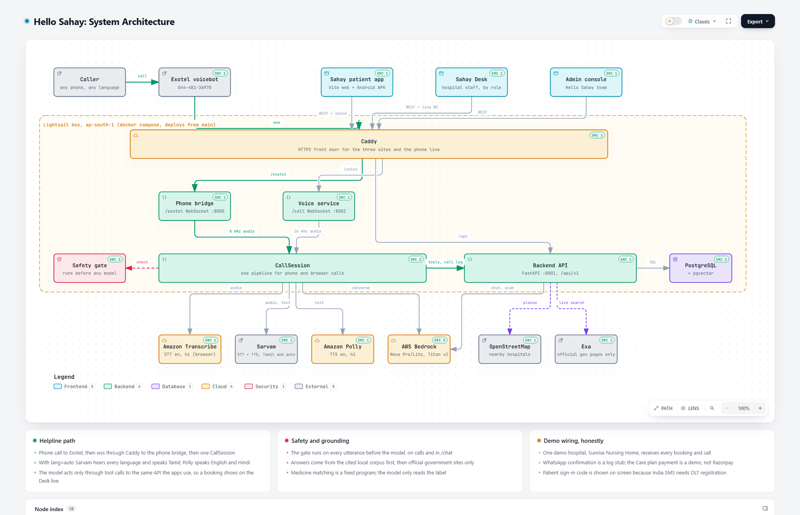
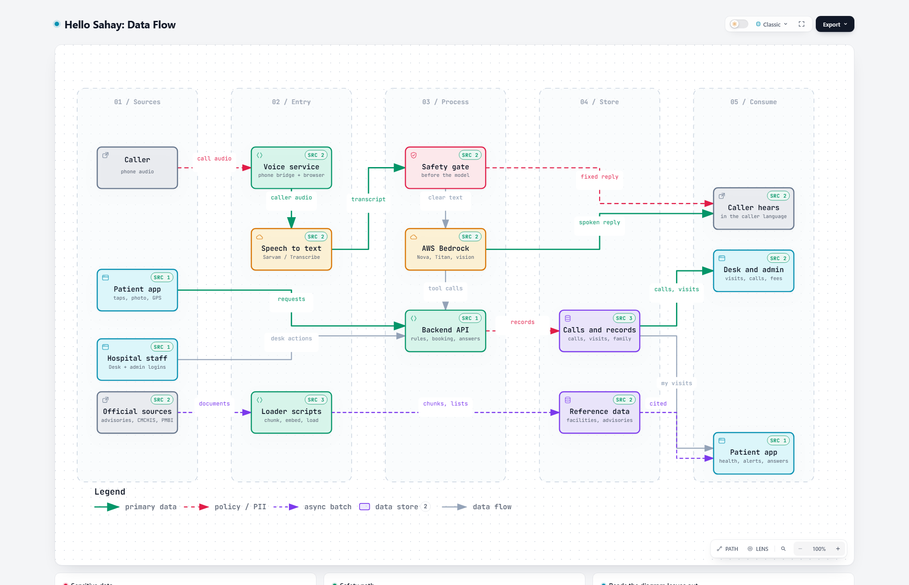

# Hello Sahay — Architecture

Status: **as built**, verified against the code at commit `8e99d39` (2026-10-15). Product background: [`PROJECT_BRIEF.md`](PROJECT_BRIEF.md).
Companion docs: [`PRODUCT_FEATURES.md`](PRODUCT_FEATURES.md) · [`PATIENT_APP_SPEC.md`](PATIENT_APP_SPEC.md) · [`FRONTEND_INTEGRATION.md`](FRONTEND_INTEGRATION.md) · [`IMPLEMENTATION_PHASES.md`](IMPLEMENTATION_PHASES.md)

## 1. The system in one picture

Two interactive diagrams (open the `.html` files in a browser; every node links to the source lines that prove it):

| Diagram | Open | Static copy |
|---|---|---|
| System architecture: who talks to whom, where it runs | [`diagrams/architecture.html`](diagrams/architecture.html) | [`diagrams/architecture.png`](diagrams/architecture.png) |
| Data flow: what data moves where, what is stored, what is never stored | [`diagrams/dataflow.html`](diagrams/dataflow.html) | [`diagrams/dataflow.png`](diagrams/dataflow.png) |

The diagrams are generated from [`diagrams/architecture.json`](diagrams/architecture.json) and [`diagrams/dataflow.json`](diagrams/dataflow.json) with the `archify` skill; edit the JSON and re-run `archify finalize` to refresh them (pinned to the commit in `meta.repository.revision`).

**Six runtime parts, one database:**

| Part | Folder | Runs as | Used by | Tech |
|---|---|---|---|---|
| Backend API | `services/api/` | `api` container, port **8001**, `/api/v1` | every client and the voice service | FastAPI, SQLAlchemy, PostgreSQL + pgvector |
| Voice service | `services/voice/pipeline/` | `voice` container, port **8002** (`/call` WebSocket, browser test page) | the patient app's "Start call" button | one `CallSession` per call: STT → safety gate → Bedrock tools → TTS |
| Phone bridge | `services/voice/telephony/` | `bridge` container, port **8000** (`/exotel`, also `/incoming` and `/media` for Twilio) | Exotel, which carries the real phone number | same `CallSession`, 8 kHz audio |
| Patient app | `apps/patient-web/` | static build served by Caddy; Android APK via Capacitor (`apps/patient-web/android`) | patients, families | Vite, React 19, TypeScript, Tailwind 4 |
| Sahay Desk | `apps/desk/` | static build served by Caddy | hospital staff, by role | Vite, React 18, Tailwind 3 |
| Admin console | `apps/admin/` | one static `index.html`, no build | the Hello Sahay team | plain HTML + fetch |

`apps/web/` (Next.js) and `apps/patient/` (Expo) are earlier builds, not deployed and not maintained; the Vite apps above replaced them. `data/` holds seed rows, advisory sources, CMCHIS and medicine data; `scripts/` holds the loaders and call tools; `deploy/` holds the one-box hosting stack.

## 2. The three user journeys

### 2.1 Helpline call (the base of everything)

Entry: a caller dials **044-481-36970** (Exotel) or taps "Start call" in the patient app. Details live in [`services/voice/README.md`](../services/voice/README.md) "Call flow".

1. Short greeting that says the call is transcribed, then "speak after the beep". The microphone stays muted until the beep has played. With `lang=auto` (the phone default) the first sentence sets the language; only a whole sentence of five or more words in another script changes it later.
2. The caller's number comes from the carrier (Exotel `start.from`) and is never asked for. `GET /patients/{phone}` tells the call whether the caller has the app and where they are; a live location (pushed within 30 minutes) is confirmed once, otherwise the village is asked.
3. **Safety gate on every utterance, before the model.** Emergency words: say 108 / 112, flag the call as an emergency and queue a human callback. Symptom questions: fixed safe reply.
4. Department comes from a fixed keyword table (`data/seed/department_keywords.csv`), never from the model.
5. `find_facilities` returns the real nearest hospital (OpenStreetMap, nearest first) as `recommended`, plus the nearest government one when different. Every hospital named is bookable.
6. `get_slots` honours `doctor_name` and `preferred_time`; `book_appointment` uses the call's number. **Demo wiring:** doctors, slots and booking are always the one demo hospital's (Sunrise Nursing Home); the real hospital's name the caller chose is saved as `appointment.hospital_label`. A doctor who is not there is never refused: the free doctor in the closest slot is booked and named.
7. A second slot choice reschedules (`PATCH /appointments/{id}`); a short thanks after a booking gets a fixed goodbye and hang-up.
8. The call record with transcript, outcome and a timestamped `trace` is posted to `POST /calls`; handoffs land in the Desk callback queue. No audio is stored.

Voice tools (Bedrock tool definitions in `services/voice/pipeline/tools.py`): `find_facilities`, `get_slots`, `book_appointment`, `check_scheme_coverage`, `set_language`, `handoff_to_human`, `emergency_redirect`. Cancel, WhatsApp send and advisory search are **not** voice tools.

Loop, noise, echo and flip-flop guards, and a goodbye plus callback queue after three unanswered turns, are in `services/voice/pipeline/session.py`.

### 2.2 Patient app

First open: language, consent, profile (name, age, gender, village, mobile), then a 6-digit code (random per request, valid 5 minutes, 5 tries, shown on screen while `OTP_SHOW_CODE=1` because India SMS needs DLT registration). Tabs: **Home** (call, emergency, today's visit, nearest hospital), **Hospitals** (real OpenStreetMap list, CMCHIS tags, Leaflet map, booking), **Ask Sahay** (cited answers), **Medicines** (search, label photo scan, Jan Aushadhi saving), **My Health** (appointments, family, reminders, Care plan, alerts). Full list: [`PATIENT_APP_SPEC.md`](PATIENT_APP_SPEC.md).

### 2.3 Hospital and admin web

- **Sahay Desk** (`apps/desk`, tabs by login role): appointments with live push, mark arrived / no-show / complete, walk-ins, doctor on-duty switch, call logs and callbacks, past visits, and (hospital admin only) Users. A `doctor` login sees only its own patients.
- **Admin console** (`apps/admin`, Hello Sahay `admin` login): overview, hospitals, hospital logins, payments, calls with transcripts, Care plan subscribers. Subscription (₹2,999) and arrival-fee (₹40) lines are derived from the partner flag and arrived appointments; counter walk-ins carry no fee.

## 3. The "verified, cited, never from model memory" rule

| Kind of answer | Where it comes from | What the user sees |
|---|---|---|
| Health advice, schemes | `advisory_chunk` rows (Titan v2 embeddings, 1024 dims, retrieved under `ADVISORY_MAX_DISTANCE`), then a live search restricted to official hosts (`gov.in`, `nic.in`, `cmchistn.com`) when the corpus has nothing | Answer rephrased from the excerpts + issuer, title, date and link; live pages carry `live: true` |
| Hospital, doctor, slot | `facility`, `doctor`, `slot`, plus OpenStreetMap names; scheme tags only from Tamil Nadu's CMCHIS empanelment list | Exact DB values; "Scheme cover not confirmed" when unmatched |
| Medicine composition and generics | `brand_medicine` (246k brands) and `janaushadhi_item` (official PMBI list), matched by a fixed program on salts + strength + form | Match, the label's own printed price when present, the saving, "confirm with your doctor or pharmacist" |

Enforced in code, not only in the prompt:
- No usable citation, `NO_ANSWER` or a Bedrock error returns the fixed fallback ("I don't have verified information on that…") with `grounded: false`.
- The model only rephrases excerpts and calls tools. The vision model on a label photo only reads printed text; it never chooses the substitute.
- The safety gate (keyword lists per language, `services/api/app/safety/`) runs before the model in both the voice session and `POST /chat`. There is no separate classifier.
- Symptom questions get a fixed safe reply plus an offer to book.

## 4. Data flow

See the data flow diagram above. In words:

- **Audio never reaches storage.** Phone audio goes to the speech-to-text provider and is dropped; only the transcript and a trace (events, timings, tool arguments) are saved with the call.
- **Personal data** (names, numbers, village, bookings, family numbers, Care plan) lives only in PostgreSQL, behind API rules: a hospital login reads only its own facility, a doctor login only its own patients, and the patient-app endpoints that need a token return only that patient's records (the open booking-list endpoint is a known gap, see section 9).
- **Reference data** (facilities, advisories, medicines, schemes) is written only by loader scripts (`scripts/ingest_advisories.py`, `load_medicines.py`, `fetch_cmchis_hospitals.py`, `load_seed.py`), never by a request.
- **Fees** are computed, not stored: ₹2,999 × partner hospitals + ₹40 × billable arrivals, plus real rows in `payment` for Care plan payments.

## 5. Data model (PostgreSQL)

Tables are created on API start-up (`init_db`). Core tables in `app/models.py`, patient-app tables in `app/models_patient_app.py`.

| Table | Key fields |
|---|---|
| `facility` | id, name, type (PHC/CHC/GH/private), address, lat, lng, phone, hours, departments[], pmjay, cmchis, is_partner, plan |
| `doctor` | id, facility_id, name, department, languages[], on_duty |
| `slot` | id, doctor_id, start, end, status (open/booked/blocked); 15-minute slots, 7 days ahead, refreshed every 6 h |
| `patient` | id, name, phone (unique, `+91…`), language, village, age, gender, consent_at, is_premium, family_phone, lat, lng, location_at |
| `appointment` | id, patient_id, slot_id, source (helpline/app/desk), reason_text, status (booked/arrived/completed/no_show/cancelled), arrived_at, hospital_label |
| `call` | id, patient_id, facility_id, language, transcript, summary, outcome, emergency, handoff, callback_done, started_at, duration_s, trace |
| `desk_user` | id, email, password_hash, role (admin/hospital_admin/receptionist/nurse/doctor), name, active, facility_id, doctor_id |
| `advisory_chunk` | id, doc_id, text, lang, embedding (vector 1024), issuer, title, url, published |
| `brand_medicine` | id, brand, key[] (sorted "salt strength"), form, manufacturer, pack, price |
| `janaushadhi_item` | id, drug_code, generic_name, key[], form, pack, mrp, group_name |
| `family_member` | id, owner_phone, name, phone, relation |
| `care_plan` | id, payer_phone, parent_phone, amount, payment_id, paid_at, active |
| `reminder` | id, patient_id, medicine_name, times[], active |
| `reminder_taken` | id, reminder_id, day, at_time, taken_at |
| `app_notification` | id, phone, kind, title, body, created_at, read |
| `payment` | id, payer_type, payer_id, kind (subscription/arrival_fee/premium), amount, status, razorpay_ref (a `DEMO-PAY-n` reference today) |

`medicine`, `medicine_price`, `jan_aushadhi_product` and `dose_log` exist from the first design but are unused; the app reads `brand_medicine`, `janaushadhi_item` and `reminder_taken`.

## 6. Backend API contract

All under `/api/v1`; `GET /health` also at the root. JSON in and out. "Open" means no token, because the voice service and the patient app call without a Desk login. Endpoint detail and roles: [`services/api/README.md`](../services/api/README.md).

| Group | Endpoints | Auth |
|---|---|---|
| Facilities | `GET /facilities?lat&lng&department&scheme`, `GET /facilities/{id}/slots?date&department` | open |
| Real hospitals | `GET /places/nearby-hospitals?lat&lng&limit` (OpenStreetMap, CMCHIS tags, cached 1 h per ~1 km cell) | open |
| Booking | `POST /appointments`, `PATCH /appointments/{id}` (reschedule, cancel, arrived, complete, no_show), `POST /appointments/walk-in`, `GET /appointments?date&history`, `GET /patients/{phone}/appointments` | open to book / reschedule / cancel; Desk token for arrived, complete, no_show, list, walk-in |
| Patients | `GET /patients/{phone}` (registered, name, village, `location_live`), `PUT /patients/{phone}/location`, `PUT /patients/me` | open / patient token |
| Auth | `POST /auth/login` (Desk or admin), `POST /auth/otp/request`, `POST /auth/otp/verify` | open |
| Chat | `POST /chat {message, lang}` → `{answer, citations[], safety_flag, grounded}`, `GET /advisories?lang` | open |
| Medicines | `GET /medicines/search?q=`, `POST /medicines/scan {image}` | patient token |
| Family and Care plan | `GET/POST /family`, `PUT/DELETE /family/{id}`, `GET /care/me`, `POST /care/pay`, `DELETE /care/plans/{id}`, `GET /care/parents` | patient token |
| Reminders and alerts | `GET/POST /reminders`, `PUT/DELETE /reminders/{id}`, `POST /reminders/{id}/taken`, `GET /notifications`, `POST /notifications/read` | patient token |
| Config | `GET /config/contacts` (helpline, emergency desk, hospital call number, 108, 112) | open |
| Calls | `POST /calls` (accepts `trace`), `GET /calls`, `GET /handoffs`, `PATCH /calls/{id}` (`callback_done`), `GET /calls/{id}/trace` | `POST` open; rest Desk or admin token |
| Doctors and users | `GET /doctors?date`, `PATCH /doctors/{id}` (`on_duty`), `GET/POST /users`, `PATCH /users/{id}` | Desk token; users: hospital admin or `admin` |
| Admin | `GET /admin/overview`, `/admin/hospitals`, `/admin/payments`, `/admin/premium`, `/admin/calls` | `admin` token |
| Live | `WS /live/desk/{facility_id}?token=` pushes `{type:"appointment"}` and `{type:"call"}` | Desk token for that facility |

Conventions: appointment JSON is `{id, status, source, reason_text, arrived_at, hospital_label, patient{…}, slot{…}, doctor{…}, facility{…}}`; phones are normalised to `+91XXXXXXXXXX`; `language` is `ta|hi|en`; `source` is `helpline|app|desk`; booking locks the slot row (`SELECT … FOR UPDATE`) so a double booking gets 409. The live hub is in-process, so run one uvicorn worker.

**Designed but not built:** `POST /medicines/lookup`, `GET /medicines/{id}/equivalents` and `/prices` (replaced by search and scan), `POST /payments/checkout` and `/payments/webhook` (Care plan payment is a demo), `GET /admin/hospitals` add/edit.

## 7. Environments and hosting

| Where | What |
|---|---|
| Local | `docker compose up -d` (Postgres + pgvector on host port **5433**), API **8001**, voice **8002**, phone bridge **8000**, patient app **5174**, Desk **5173**; psycopg2 driver (`postgresql+psycopg2://…`) |
| Hosted | One AWS Lightsail instance `sahay` (ap-south-1, static IP) running `deploy/docker-compose.yml`: db, api, voice, bridge, Caddy. A cron job redeploys from `origin/main` within a minute, so **pushing to `main` is the deploy**; frontends are rebuilt only when their folder changed |
| Names | Patient app `https://13-127-85-246.sslip.io` (also `sahay.…`), Desk `desk.…` / `sahaydesk.…`, admin `admin.…` / `hellosahay.…`; Exotel voicebot `wss://13-127-85-246.sslip.io/exotel` |
| Phone | Exotel call flow "Hello Sahay Voicebot" attached to 044-481-36970. Trial rules: only verified numbers call, 7-day trial |
| Android | Capacitor wrapper in `apps/patient-web/android`, built with Gradle; API and voice URLs are baked in at build time (`deploy/README.md`) |
| AWS | Personal account only (`AWS_PROFILE=personal-bedrock`, ap-south-1). Nova and Titan work on credits; Claude models on Bedrock need a card and are not used |

## 8. Key technical decisions

| Decision | Why |
|---|---|
| One FastAPI backend, one router file per domain | Surprise challenges add a module, not a service |
| Safety gate is plain code (keyword lists per language), runs before the model, shared by voice and chat | The domain rule is no AI medical decisions; deterministic is provable |
| Department chosen by keyword table, not the model | Picking a department from symptoms is triage |
| Composition match is exact on salts + strength + form, by a fixed program | "Similar" medicines with a different salt or strength are unsafe; the model only reads the label |
| Self-built voice pipeline (no Vapi/Bolna) | Hackathon rule: ready-made agent platforms earn less credit |
| Sarvam for Tamil STT and TTS and for `lang=auto` STT; Transcribe + Polly for fixed English/Hindi | Transcribe has no Tamil streaming; Polly has no Tamil |
| Exotel for the real number | Indian number, no international calling, works from any Indian phone; Twilio was dropped |
| Answers come from corpus first, then official-host live search | Fresh government information without letting a private or news page be cited |
| Auth: Desk by email + password (JWT, 12 h, `facility_id` from the token); patients by phone + random code (JWT, 30 days) | Fast to build, enough for the demo |
| One demo hospital receives every booking and call | A real, honest line between real (names, distance, schemes) and demo (doctors, slots, bookings) |

## 9. Known gaps

- WhatsApp confirmation is a log line (`app/notify.py`); needs keys.
- `POST /calls` and `POST /appointments` are open (the voice service has no token), and `GET /patients/{phone}/appointments` is open; add a service key before real use.
- Care plan payment is a demo; Razorpay is not wired. Patient code is shown on screen.
- A real phone call has been placed on the hosted box only from synthetic callers; the box clock is UTC, so "tomorrow" said between 00:00 and 05:30 IST can resolve to today.
- No keypad (DTMF) fallback and no 3-checks-a-day limit on medicines; both were designed, neither built.

## 10. Data sources

| Need | Source | Note |
|---|---|---|
| Advisories | MoHFW, NHM, NCVBDC, NCDC, NHA PM-JAY, CMCHIS site, PMBI (`data/advisories/sources.csv`) | Issuer, title, URL, date per file |
| Scheme cover | Tamil Nadu CMCHIS empanelment list (`data/schemes/cmchis_hospitals.json`) | PM-JAY has no open per-hospital list; tagged together because Tamil Nadu runs both on one list |
| Generics + price | PMBI Jan Aushadhi list (`data/medicines/janaushadhi_mrp.csv`) | Official |
| Brand → composition + market price | Public Indian medicine dataset (`data/medicines/brands.csv.gz`, 246k rows), see `data/medicines/SOURCES.md` | Demo use; **no live scraping** of pharmacy sites |
| Real hospitals | OpenStreetMap (Nominatim) | Live lookup |
| Demo facilities, doctors, slots | `data/seed/` (Chengalpattu district, 10 facilities) | Labelled **DEMO DATA** |

## 11. Team and tool split

| Who | Does what |
|---|---|
| Hussain + Claude (Opus) | Planning, architecture, reviews, hard bugs, these docs |
| Claude sessions (Sonnet) | Implementation from task cards, one folder each, coordinated through `.claude/coordination/BOARD.md` |
| Gemini / Antigravity teammates | Research and the original Desk and patient prototypes |
| Designer (Google AI Studio) | Screens, kept in `design/ai-studio/` as a visual reference only |
| Business member | Clinic calls, pricing validation, pitch ([`BUSINESS.md`](BUSINESS.md)) |
