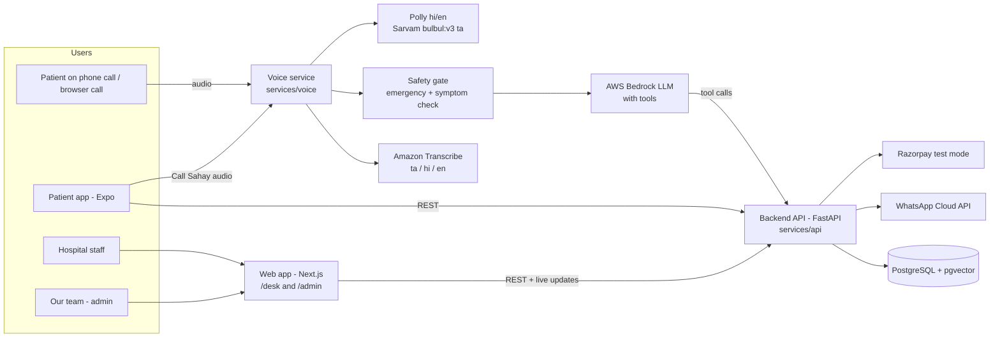

# Hello Sahay — Hackathon Architecture

Status: plan for Founder's Code 2026 (14–15 Oct 2026). Product background: [`PROJECT_BRIEF.md`](PROJECT_BRIEF.md).
Companion docs: [`PATIENT_APP_SPEC.md`](PATIENT_APP_SPEC.md) · [`IMPLEMENTATION_PHASES.md`](IMPLEMENTATION_PHASES.md) · [`FRONTEND_DELIVERABLES.md`](FRONTEND_DELIVERABLES.md)

## 1. The system in one picture

**Five parts, one database:**

| Part | Folder | Who uses it | Tech |
|---|---|---|---|
| Backend API | `services/api/` | everything talks to it | FastAPI, PostgreSQL + pgvector |
| Voice service | `services/voice/` | callers | WebSocket pipeline: Transcribe → safety gate → Bedrock tools → TTS |
| Patient app | `apps/patient/` | patients, families | Expo React Native |
| Web app | `apps/web/` | hospitals (`/desk`) and our team (`/admin`), plus the browser "Call Sahay" demo page (`/call`) | Next.js |
| Data | `data/` | seed + sources | CSV/JSON, every row with a source |

The hospital dashboard (Sahay Desk) and our admin dashboard are **one Next.js app with two role-based areas**, not two apps. Less to build, one login system.

## 2. The three user journeys

### 2.1 Helpline call (the base of everything)
1. Consent line + language choice ("press 1 Tamil, 2 Hindi, 3 English" or speak).
2. **Safety gate runs on every utterance first.** Emergency words → "Call 108 now", offer human transfer, log the call as emergency. Stop.
3. Collect **name, phone number, village/location, and reason for visit**. The reason is recorded as the caller's own words; it is **not** turned into a diagnosis.
4. Pick the department with a **fixed lookup table**, not AI judgment (`data/seed/department_keywords.csv`: "pregnancy" → Obstetrics, "child" → Paediatrics, "eye" → Ophthalmology, "tooth" → Dental, anything else → General Medicine). If unsure, ask the caller "which doctor do you want to see?"
5. `find_facilities` returns nearby options, **government first**, with scheme flags (PM-JAY / CMCHIS).
6. **Partner hospital** (`is_partner = true`): offer slots → book → appointment appears live on that hospital's Desk → WhatsApp confirmation.
   **Non-partner hospital**: give address, phone, hours, distance and how to reach it; offer to send it on WhatsApp. No booking.
7. Save the call: transcript, structured summary, outcome (booked / info given / emergency / handed off).

### 2.2 Patient app
Chat (RAG with citations), medicine composition checker, price comparison, appointments, "Call Sahay", and the paid Care plan (alarms + adherence). Full list in [`PATIENT_APP_SPEC.md`](PATIENT_APP_SPEC.md).

### 2.3 Hospital and admin web
- **Desk (`/desk`, hospital staff):** today's appointments, slot management, check-in button (marks "patient arrived" — this is what triggers the ₹40 arrival fee), call transcripts, human-handoff queue.
- **Admin (`/admin`, our team):** analytics across all calls and hospitals, hospital client management (add hospital, mark as partner, plan), payments (subscriptions, arrival fees, app premium), premium users.

## 3. The "verified, cited, never from model memory" rule

Every fact the system tells a user comes from a stored source, never from the LLM's own knowledge:

| Kind of answer | Where it comes from | What the user sees |
|---|---|---|
| Health advice / advisories | `advisory_chunk` table (RAG over MoHFW, NHM, TN Health Dept, WHO India docs) | Answer close to verbatim + "Source: <issuer>, <title>, <date>" with link |
| Hospital, doctor, slot, scheme info | `facility`, `doctor`, `slot` tables | Exact values from the DB |
| Medicine composition and generics | `medicine` table (brand → salts, strength, form) | Match result + source of the row |
| Prices | `medicine_price` table with `source` and `fetched_at` per row | Price + "Price from <source> on <date>" |

Rules enforced in code, not just the prompt:
- If retrieval returns nothing above the confidence threshold → fixed reply: "I don't have verified information on that. Please ask at your nearest PHC or call 104." No free-form answer.
- The LLM may only (a) call tools and (b) rephrase tool results. The system prompt says so, **and** the API rejects answers on the health path that carry no citation.
- Symptom questions ("what is this pain?") → fixed safe reply + offer to book + 108 if urgent words.

## 4. Data model (PostgreSQL)

| Table | Key fields |
|---|---|
| `facility` | id, name, type (PHC/CHC/GH/private), address, lat, lng, phone, hours, departments[], pmjay, cmchis, is_partner, plan |
| `doctor` | id, facility_id, name, department, languages[] |
| `slot` | id, doctor_id, start, end, status (open/booked/blocked) |
| `patient` | id, name, phone, language, village, consent_at, is_premium, family_phone |
| `appointment` | id, patient_id, slot_id, source (helpline/app/desk), reason_text, status (booked/arrived/no_show/cancelled), arrived_at |
| `desk_user` | id, email, password_hash, role (hospital/admin), facility_id |
| `call` | id, patient_id, facility_id (nullable), language, transcript, summary, outcome, emergency, handoff, started_at, duration_s |
| `advisory_chunk` | id, doc_id, text, lang, embedding, issuer, title, url, published |
| `medicine` | id, brand, salts (normalized, sorted), strength, form, manufacturer, source |
| `medicine_price` | id, medicine_id, mrp, pack, source, fetched_at |
| `jan_aushadhi_product` | id, generic_name, salts, strength, form, mrp, source |
| `reminder` | id, patient_id, medicine_name, times[], active |
| `dose_log` | id, reminder_id, scheduled_at, status (taken/missed/snoozed) |
| `payment` | id, payer_type (hospital/patient), payer_id, kind (subscription/arrival_fee/premium), amount, status, razorpay_ref |

## 5. Backend API contract (first cut)

All under `/api/v1`. JSON in and out. Implementers: keep these names so the voice tools, app and web all match.

| Method + path | Purpose |
|---|---|
| `GET /facilities?lat&lng&department&scheme` | Nearby facilities, government first, with `is_partner` and scheme flags |
| `GET /facilities/{id}/slots?date` | Open slots (partner hospitals only) |
| `POST /appointments` | Book `{patient, slot_id, source, reason_text}` → sends WhatsApp |
| `PATCH /appointments/{id}` | Reschedule / cancel / mark arrived |
| `GET /patients/{phone}/appointments` | Patient's appointments |
| `POST /chat` | `{message, lang}` → `{answer, citations[], safety_flag}` (same safety gate as voice) |
| `GET /advisories?lang` | Advisory feed with sources |
| `POST /medicines/lookup` | `{text}` or `{image}` → identified brand + composition |
| `GET /medicines/{id}/equivalents` | Same salts + strength + form, cheapest first, Jan Aushadhi flagged |
| `GET /medicines/{id}/prices` | Prices with source and date |
| `POST /reminders`, `GET /reminders`, `POST /doses/{id}` | Care plan (premium-gated) |
| `POST /calls`, `GET /calls?facility_id` | Call log + transcripts |
| `GET /handoffs` | Human-handoff queue |
| `POST /payments/checkout`, `POST /payments/webhook` | Razorpay test mode |
| `GET /admin/analytics`, `GET/POST /admin/hospitals` | Admin console |
| `WS /live/desk/{facility_id}` | Live push of new bookings and calls to the Desk |
| `POST /auth/login` | Desk/admin `{email, password}` → `{token, role, facility_id}` (demo users seeded) |
| `POST /auth/otp/request`, `POST /auth/otp/verify` | Patient `{phone}` then `{phone, code}` (code = `DEMO_OTP`) → `{token, patient}` |
| `GET /appointments?date` | Desk list for the token's facility (`facility_id` from the JWT) |

**As built (9945460):**
- Appointment JSON everywhere: `{id, status, source, reason_text, arrived_at, patient{id,name,phone,language,village}, slot{id,start,end}, doctor{id,name,department}, facility{id,name,address,phone}}`.
- WS pushes `{type:"appointment", appointment}` and `{type:"call", call}`.
- Slots: `[{slot_id, start, end, doctor_id, doctor_name, department}]`, optional `&department=`; a non-partner facility returns 404.
- Phones are normalised to `+91XXXXXXXXXX`; `language` is `ta|hi|en`; `source` is `helpline|app|desk`.
- Auth: `PATCH action=arrived` (it triggers the ₹40 fee), `GET /appointments`, `GET /calls` and `GET /handoffs` need a desk/admin Bearer token scoped to its facility. `WS /live/desk/{id}?token=` is optional. `POST /appointments`, `POST /calls`, reschedule/cancel and `GET /patients/{phone}/appointments` are open, because voice has no token. ponytail: add a service key before real use.
- Demo logins: `desk<facility_id>@sahay.demo`, `admin@sahay.demo`, password `demo1234`.

Local ports: API **8001** (`uvicorn app.main:app --app-dir services/api --port 8001`), voice **8002**, phone bridge **8000**, web **3000**. DB driver is psycopg2 (`postgresql+psycopg2://…`) because psycopg 3 is not installed and PyPI is slow here.

**Voice tool names** (Bedrock tool definitions) map 1:1 onto these: `find_facilities`, `get_slots`, `book_appointment`, `reschedule_appointment`, `cancel_appointment`, `check_scheme_coverage`, `search_advisories`, `send_whatsapp`, `handoff_to_human`, `emergency_redirect`.

## 6. Key technical decisions

| Decision | Why |
|---|---|
| One FastAPI backend, modules per domain (`facilities`, `booking`, `chat`, `medicines`, `care`, `payments`, `admin`) | Surprise challenges add a module, not a service |
| Safety gate is plain code (keyword lists per language + a small classifier), runs **before** the LLM | Judges and the domain rule require no AI medical decisions; deterministic is provable |
| Department chosen by keyword table, not the LLM | Choosing a department from symptoms is triage; keep it out of the model |
| Composition match is **exact** on (sorted salts, strength, form) | "Similar" medicines that differ in salt or strength are unsafe; fuzzy matching is only used to read the brand name |
| Browser "Call Sahay" is the main voice demo | A real Indian number needs telecom KYC (2–3 days) |
| Razorpay **test mode** for payments | Shows the business model working without real money |
| Auth: patients by phone + demo OTP; Desk/admin by email + password, JWT with role (`hospital`, `admin`) | Fast to build, enough for a demo; `facility_id` comes from the token, never from the request |
| Host on AWS Mumbai (`ap-south-1`) where models are available | DPDP data residency story |

## 7. Data sources (verify each before building on it)

| Need | Source | Note |
|---|---|---|
| Advisories | MoHFW, NHM, Tamil Nadu Health Dept, NCDC PDFs (dengue, heat, snakebite first aid, immunisation schedule), PM-JAY and CMCHIS FAQs | Store issuer, title, URL, date per chunk |
| Generic equivalents + price | Jan Aushadhi (PMBI) product list with MRP | Verify format (PDF/Excel) |
| Price ceilings | NPPA ceiling price list | Public government data |
| Brand → composition + market price | Public "Indian medicine" datasets (e.g. Kaggle A-Z medicine dataset) | Demo use only, cite the dataset; **do not scrape** 1mg / PharmEasy live (terms of service) |
| Facilities | Demo district (Tamil Nadu, near Chennai): 8–12 facilities | Labelled **DEMO DATA** |

## 8. Team and tool split

| Who | Does what | Works from |
|---|---|---|
| Hussain + Claude (Opus) | Planning, architecture, reviews, evaluation, hard bugs, these docs | All docs |
| Gemini / Antigravity | Implementation and research tasks | [`IMPLEMENTATION_PHASES.md`](IMPLEMENTATION_PHASES.md) task cards + this API contract |
| Designer (Google AI Studio) | Screens for the patient app, Desk and admin | [`FRONTEND_DELIVERABLES.md`](FRONTEND_DELIVERABLES.md) |
| Business member | Clinic calls, pricing validation, pitch | `PROJECT_BRIEF.md` §5 |

AI Studio output is a **visual reference**: it generates React web code wired directly to Gemini with the key in the browser. Commit it once as `chore: import AI Studio UI prototype (pre-event reference)` under `design/ai-studio/`, then rebuild the screens properly in Expo and Next.js against this API.
